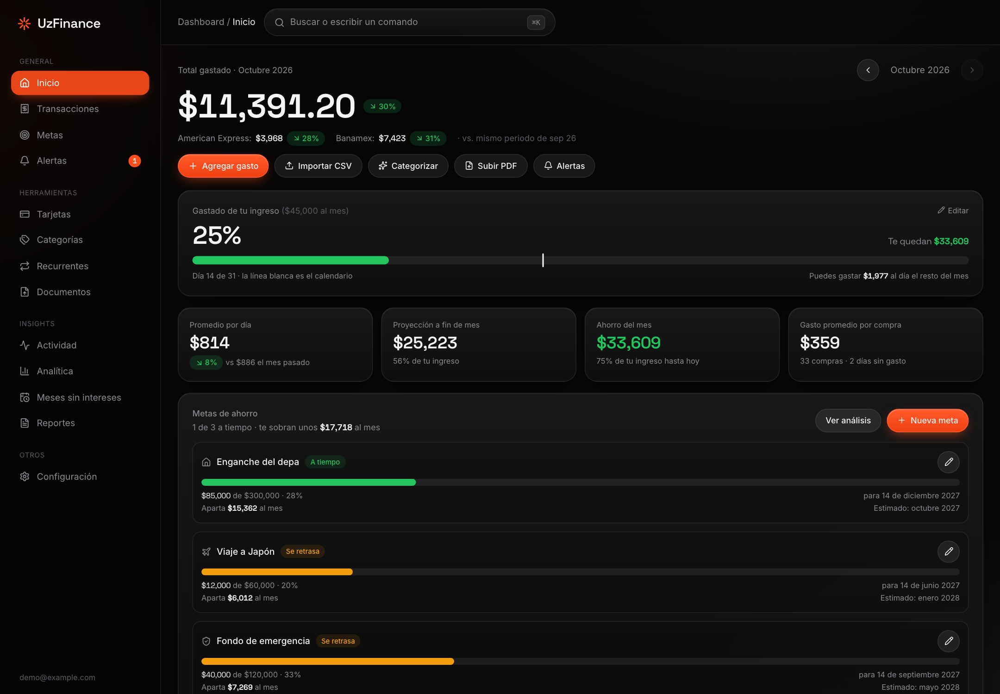
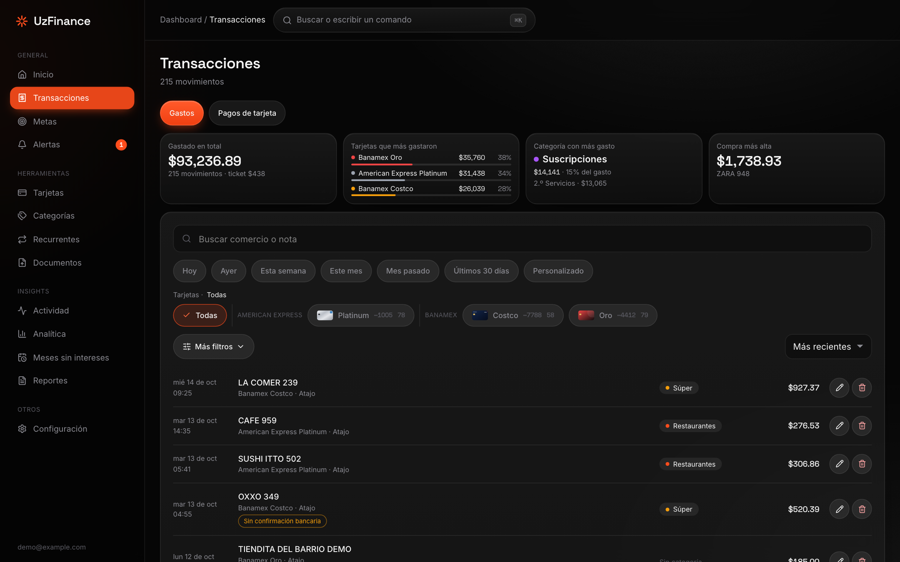
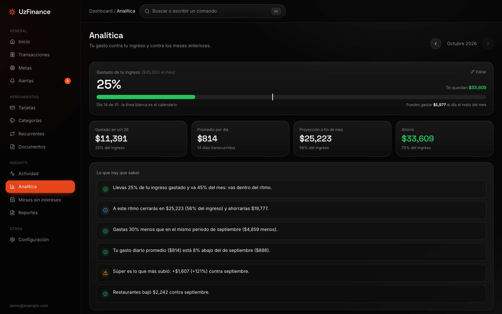
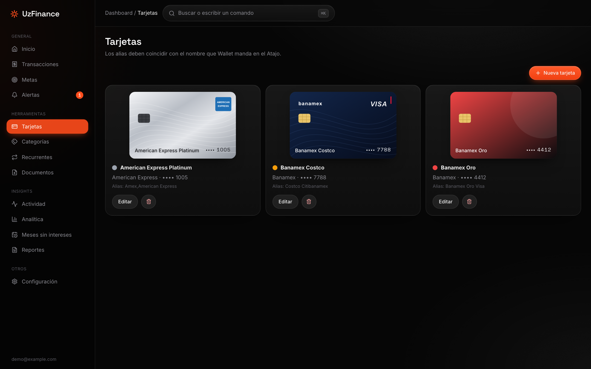
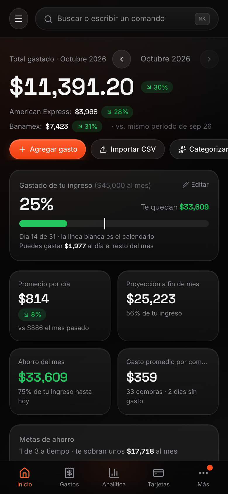
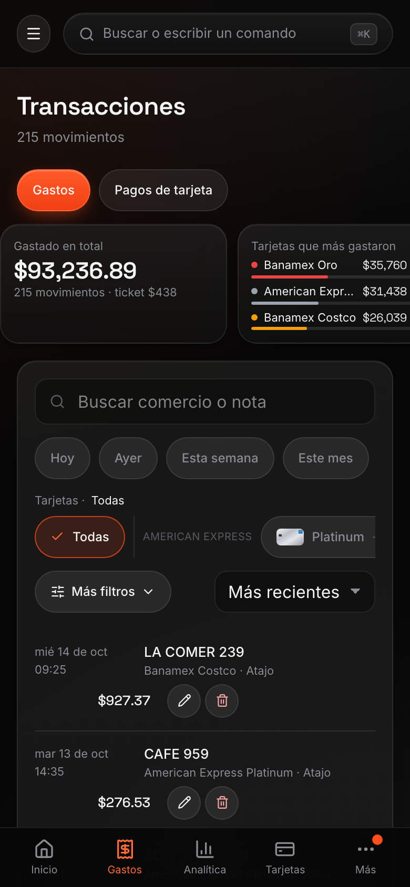
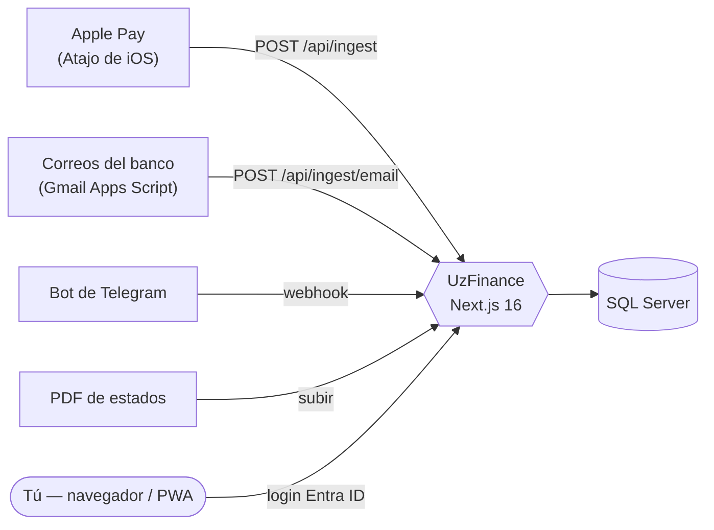

<div align="center">


# UzFinance

**Tus gastos con tarjeta, registrados solos. Autoalojado, privado y hecho para México.**

Cada pago con Apple Pay, correo del banco y estado de cuenta en PDF cae en un solo tablero: sin darle tus claves del banco a nadie, sin agregadores de terceros y sin suscripción. Tus datos viven en **tu** Azure.

[](https://github.com/Aplex2723/UzFinance/actions/workflows/deploy.yml)
[](LICENSE)
[](https://nextjs.org)
[](docs/ARCHITECTURE.md)
[](docs/DEPLOY-AZURE.md)
[](CONTRIBUTING.md)

[English](README.md) · [Inicio rápido](#-inicio-rápido) · [Funciones](#-funciones) · [Despliegue en Azure](docs/DEPLOY-AZURE.md) · [Contribuir](CONTRIBUTING.md)



<sub>Todas las capturas usan datos inventados (<code>npm run db:seed</code>).</sub>

</div>

---

## ¿Por qué UzFinance?

Los bancos mexicanos no tienen APIs de open banking, y los agregadores te piden tu contraseña de banca en línea. UzFinance toma otro camino: escucha las señales que **ya recibes** y las junta en un solo libro de movimientos sin duplicados.

- **Cero captura.** Un Atajo de iPhone se dispara con cada compra de Apple Pay y la manda a tu servidor.
- **Cero credenciales.** Los avisos de compra de Banamex se leen de tu propio Gmail con un Apps Script que tú controlas.
- **Cero ataduras.** SQL Server normal, montos en centavos enteros, exportación a CSV. Tus datos son tuyos.
- **Casi cero costo.** Corre en el nivel gratuito de Azure (o ≈ US$18 al mes si lo quieres siempre encendido), con presupuesto y alertas para que nada te sorprenda.

## ✨ Funciones

| | |
|---|---|
| ⚡ **Captura automática** | Apple Pay → Atajo de iOS → `/api/ingest`. Correos del banco (Banamex) → Gmail Apps Script. Bot de Telegram para gastos a mano (`350 starbucks`). Dos fuentes de la misma compra se **fusionan en una sola transacción** |
| 📊 **Tablero** | Gasto del mes vs. ingreso, presupuesto diario, proyección a fin de mes, gasto por día de la semana, flujo **Sankey** tarjeta → categoría, mapa de calor de 12 semanas e insights por reglas («gastas 30 % menos que el mes pasado») |
| 💳 **Tarjetas y MSI** | Tarjetas ilustradas por emisor, desglose por tarjeta y planes de **meses sin intereses** con saldo pendiente y fecha de término |
| 🎯 **Metas de ahorro** | Varias metas con prioridad; una predicción en cascada te dice cuáles llegas a tiempo y qué recortar para el resto |
| ✨ **UzChat** | Un orbe flotante abre un asesor de finanzas personales: pregunta cuánto gastaste, qué categorías pesan más o «¿puedo ahorrar $50,000 en 6 meses?». Consulta tus datos con herramientas de solo lectura (toda cuenta pasa por una calculadora) y responde en vivo. Opcional: requiere una llave de OpenRouter; **sí** manda al modelo los comercios y montos que consulta (ver [docs/GUIA.md](docs/GUIA.md)) |
| 🔌 **Servidor MCP** | `/api/mcp` expone las herramientas de solo lectura de UzChat a cualquier cliente MCP (Claude Code, Cursor, VS Code…) con tokens Bearer por cliente (`MCP_TOKENS`); sin tokens rechaza todo. Ver `docs/GUIA.md` §14. |
| 🧾 **Estados de cuenta y comprobantes** | Sube PDF de Amex / Banamex / Nu: extractores deterministas con verificación de totales (**ningún LLM lee tus cifras**). Comprobantes de transferencia por OCR (Azure AI Vision o Tesseract 100 % local) |
| 🏷️ **Categorías inteligentes** | Tus reglas → tu historial → LLM opcional (OpenRouter) que solo ve el nombre del comercio. Lo dudoso queda en cola para que lo confirmes una vez |
| 🔔 **Alertas** | Cargos inusuales, diferencias de conciliación, horas de silencio; aviso opcional por Telegram |
| 📱 **PWA instalable** | Agrégala a la pantalla de inicio del iPhone. A propósito **sin service worker**: nada financiero se guarda en caché del dispositivo |
| 🔐 **Segura por defecto** | Login con Entra ID para una sola cuenta permitida, despliegues OIDC sin secretos, acceso a la base con identidad administrada, CSP estricta, límites de tasa. Ver el [modelo de seguridad](docs/SECURITY-MODEL.md) |

<details>
<summary><b>Más capturas</b></summary>
<br>

| Transacciones con filtros dinámicos | Analítica |
|---|---|
|  |  |

| Tarjetas | Celular |
|---|---|
|  |   |

</details>

## 🧭 Cómo funciona



Más detalle en [docs/ARCHITECTURE.md](docs/ARCHITECTURE.md).

## 🚀 Inicio rápido

Pruébalo en local con datos de ejemplo en un par de minutos. Necesitas **Node 24** y **Docker** (Docker Desktop, OrbStack…). En Apple Silicon la imagen de SQL Server corre emulada.

```bash
git clone https://github.com/Aplex2723/UzFinance.git && cd UzFinance
cp .env.example .env        # luego define DB_PASSWORD y DB_SA_PASSWORD (mismo valor, robusto) e INGEST_TOKEN
npm ci
npm run db:up               # SQL Server 2022 en Docker, solo en 127.0.0.1
npm run db:migrate && npm run db:seed
npm run dev                 # http://localhost:3000 — AUTH_MODE=dev omite el login (solo local)
```

Mándate una compra:

```bash
curl -X POST localhost:3000/api/ingest \
  -H "Authorization: Bearer $(grep ^INGEST_TOKEN= .env | cut -d= -f2)" \
  -H "Content-Type: application/json" \
  -d '{"merchant":"OXXO","amount":"45.50","card":"Banamex Oro"}'
```

## ☁️ Despliégalo en tu Azure

[`docs/DEPLOY-AZURE.md`](docs/DEPLOY-AZURE.md) te lleva de `az group create` a un despliegue en verde (App Service + Azure SQL + Entra ID).

| Perfil | Costo | Notas |
|---|---|---|
| Gratis | US$0 | App Service F1 + oferta gratuita de SQL serverless. La app se duerme y la base se pausa |
| Siempre encendido | ≈ US$18 al mes | B1 + SQL Basic. Lo que usa el mantenedor |

Los despliegues son un `git push`: GitHub Actions corre lint, typecheck, pruebas unitarias y de integración (contra un SQL Server desechable), compila, entra a Azure por **OIDC (sin secretos guardados)**, despliega y hace un smoke test. **Los forks nunca despliegan**: el job solo corre si el repo tiene configuradas tus variables de Azure.

> ⚠️ Azure no tiene un tope duro de gasto. Configura el presupuesto y las alertas de la guía antes de dejar algo corriendo.

## 📚 Documentación

| | |
|---|---|
| [Guía de operación](docs/GUIA.md) | Día a día: Gmail, Wallet, estados de cuenta, alertas, bots de chat, trampas conocidas |
| [Despliegue en Azure](docs/DEPLOY-AZURE.md) | Aprovisionamiento, costos, rotación de token, destrucción, solución de problemas |
| [Atajo de iPhone](docs/SHORTCUT.md) | Registra cada compra de Apple Pay |
| [Correos de Banamex](docs/BANAMEX-EMAIL.md) | Parser, reglas de fusión, tokens |
| [Arquitectura](docs/ARCHITECTURE.md) · [Seguridad](docs/SECURITY-MODEL.md) · [Desarrollo](docs/DEVELOPMENT.md) | |

## 🤝 Contribuir

Reportes de errores, parsers de otros bancos (BBVA, Santander, HSBC…), traducciones y documentación son bienvenidos. Empieza por [CONTRIBUTING.md](CONTRIBUTING.md) y busca los issues con la etiqueta `good first issue`. **Nunca** incluyas datos financieros reales en issues ni PRs: los fixtures deben ser inventados.

¿Encontraste una vulnerabilidad? Sigue [SECURITY.md](SECURITY.md) en lugar de abrir un issue público.

## 📄 Licencia y aviso

[MIT](LICENSE) © 2026 Aplex2723 y colaboradores.

UzFinance es un proyecto independiente. **No está afiliado, respaldado ni patrocinado** por American Express, Banamex/Citi, Nu, Apple, Microsoft, Meta ni Telegram. Los nombres de productos y empresas son marcas de sus dueños y se usan solo para describir compatibilidad; las tarjetas de la app son SVG originales, no imágenes oficiales. Este software maneja datos sensibles: tú eres responsable de cómo lo despliegas y proteges.
