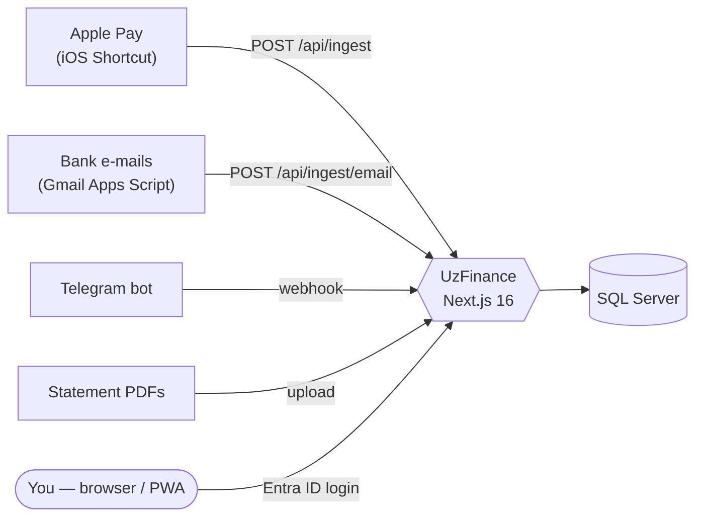

<div align="center">


# UzFinance

**Your credit-card spending, tracked automatically. Self-hosted, private, and built for Mexico.**

Every Apple Pay tap, bank e-mail and statement PDF lands in one dashboard — no bank logins, no third-party aggregators, no subscription. Your data lives in **your** Azure.

[](https://github.com/Aplex2723/UzFinance/actions/workflows/deploy.yml)
[](LICENSE)
[](https://nextjs.org)
[](docs/ARCHITECTURE.md)
[](docs/DEPLOY-AZURE.md)
[](CONTRIBUTING.md)

[Español](README.es.md) · [Quick start](#-quick-start) · [Features](#-features) · [Deploy to Azure](docs/DEPLOY-AZURE.md) · [Contributing](CONTRIBUTING.md)


<sub>All screenshots use invented demo data (<code>npm run db:seed</code>).</sub>

</div>

---

## Why UzFinance?

Mexican banks don't offer open banking APIs, and aggregators want your online-banking password. UzFinance takes a different route: it listens to the signals **you already receive** and merges them into a single, deduplicated ledger.

- **Zero typing.** An iPhone Shortcut fires on every Apple Pay purchase and POSTs it to your server.
- **Zero credentials.** Banamex purchase alerts are read from your own Gmail by a tiny Apps Script you control.
- **Zero lock-in.** Plain SQL Server, amounts in integer cents, CSV export. Your data is yours.
- **Near-zero cost.** Runs on Azure's free tier (or ≈ US$18/mo if you want it always-on), with a budget guard so nothing surprises you.

## ✨ Features

| | |
|---|---|
| ⚡ **Automatic capture** | Apple Pay → iOS Shortcut → `/api/ingest`. Bank e-mails (Banamex) → Gmail Apps Script. Telegram bot for manual entries (`350 starbucks`). Two sources for the same purchase are **merged into one transaction** |
| 📊 **Dashboard** | Month-to-date spend vs. income, daily budget, end-of-month projection, spend by weekday, card → category **Sankey** flow, 12-week heatmap, rule-based insights ("you spend 30 % less than last month") |
| 💳 **Cards & installments** | Illustrated cards per issuer, per-card breakdown, **meses sin intereses (MSI)** plans with remaining balance and payoff dates |
| 🎯 **Savings goals** | Several goals at once with priorities; a cascade forecast tells you which ones you'll hit on time and what to cut to make the rest |
| ✨ **UzChat** | A floating orb opens a personal-finance assistant: ask what you spent, which categories weigh most, or "can I save $50,000 in 6 months?". It queries your data through read-only tools (all math goes through a calculator) and streams the answer. Optional: needs an OpenRouter key; it **does** send the merchants and amounts it looks up to the model (see [docs/GUIA.md](docs/GUIA.md)) |
| 🔌 **MCP server** | `/api/mcp` exposes UzChat's read-only tools to any MCP client (Claude Code, Cursor, VS Code…) behind per-client Bearer tokens (`MCP_TOKENS`); fails closed without tokens. See `docs/GUIA.md` §14. |
| 🧾 **Statements & receipts** | Upload Amex / Banamex / Nu statement PDFs: deterministic extractors with total verification (**no LLM ever reads your numbers**). Transfer receipts via OCR (Azure AI Vision, or fully local Tesseract) |
| 🏷️ **Smart categories** | Your rules → your history → optional LLM fallback (OpenRouter) that only sees the merchant name. Anything uncertain is queued for you to confirm once |
| 🔔 **Alerts** | Unusual charges, reconciliation gaps, quiet hours; optional push to Telegram |
| 📱 **Installable PWA** | Add to the iPhone home screen. Deliberately **no service worker**: nothing financial is cached on the device |
| 🔐 **Secure by default** | Entra ID login for a single allow-listed account, secretless OIDC deploys, managed-identity DB access, strict CSP, rate limits. See the [security model](docs/SECURITY-MODEL.md) |

<details>
<summary><b>More screenshots</b></summary>
<br>

| Transactions with dynamic filters | Analytics |
|---|---|
|  |  |

| Cards | Mobile |
|---|---|
|  |   |

</details>

## 🧭 How it works



Details in [docs/ARCHITECTURE.md](docs/ARCHITECTURE.md).

## 🚀 Quick start

Try it locally with demo data in a couple of minutes. You need **Node 24** and **Docker** (Docker Desktop, OrbStack, …). The SQL Server image runs under emulation on Apple Silicon.

```bash
git clone https://github.com/Aplex2723/UzFinance.git && cd UzFinance
cp .env.example .env        # then set DB_PASSWORD and DB_SA_PASSWORD (same strong value) and INGEST_TOKEN
npm ci
npm run db:up               # SQL Server 2022 in Docker, bound to 127.0.0.1
npm run db:migrate && npm run db:seed
npm run dev                 # http://localhost:3000 — AUTH_MODE=dev skips login (local only)
```

Send yourself a purchase:

```bash
curl -X POST localhost:3000/api/ingest \
  -H "Authorization: Bearer $(grep ^INGEST_TOKEN= .env | cut -d= -f2)" \
  -H "Content-Type: application/json" \
  -d '{"merchant":"OXXO","amount":"45.50","card":"Banamex Oro"}'
```

> The UI is in **Spanish** and the money is **MXN**. Translations and other countries' bank parsers are very welcome — see [Contributing](CONTRIBUTING.md).

## ☁️ Deploy to your own Azure

[`docs/DEPLOY-AZURE.md`](docs/DEPLOY-AZURE.md) walks you through App Service + Azure SQL + Entra ID, from `az group create` to a green deploy. Highlights:

| Profile | Cost | Notes |
|---|---|---|
| Free | US$0 | App Service F1 + SQL serverless free offer. The app sleeps; the DB auto-pauses |
| Always-on | ≈ US$18 / mo | B1 + SQL Basic. What the maintainer runs |

Deploys are a `git push`: GitHub Actions runs lint, typecheck, unit + integration tests (against a throwaway SQL Server), builds, logs in to Azure with **OIDC (no secrets stored)**, deploys and smoke-tests. **Forks never deploy** — the deploy job only runs when the repo has your Azure variables configured.

> ⚠️ Azure has no hard spending cap. Set up the budget and alerts from the guide before leaving anything running.

## 🧱 Tech stack

Next.js 16 (App Router) · React 19 · TypeScript · Tailwind CSS v4 · Recharts + d3-sankey · SQL Server (`mssql`) · zod · Vitest · Playwright · Tesseract.js / Azure AI Vision · GitHub Actions · Azure App Service.

## 📚 Documentation

| | |
|---|---|
| [Operations guide](docs/GUIA.md) | Day-to-day runbook: Gmail, Wallet, statements, alerts, chat bots, gotchas (Spanish) |
| [Deploy to Azure](docs/DEPLOY-AZURE.md) | Provisioning, costs, rotation, teardown, troubleshooting (Spanish) |
| [iPhone Shortcut](docs/SHORTCUT.md) | Capture every Apple Pay purchase (Spanish) |
| [Banamex e-mail ingestion](docs/BANAMEX-EMAIL.md) | Parser, merge rules, tokens (Spanish) |
| [Architecture](docs/ARCHITECTURE.md) · [Security model](docs/SECURITY-MODEL.md) · [Development](docs/DEVELOPMENT.md) | |

## 🤝 Contributing

Bug reports, new bank parsers (BBVA, Santander, HSBC…), translations and docs are all welcome. Start with [CONTRIBUTING.md](CONTRIBUTING.md) and look for issues labelled `good first issue`. Please **never** include real financial data in issues or PRs — fixtures must be invented.

Found a vulnerability? Please follow [SECURITY.md](SECURITY.md) instead of opening a public issue.

## 📄 License & disclaimer

[MIT](LICENSE) © 2026 Aplex2723 and contributors.

UzFinance is an independent project. It is **not affiliated with, endorsed by, or sponsored by** American Express, Banamex/Citi, Nu, Apple, Microsoft, Meta or Telegram. Product and company names are trademarks of their respective owners and are used only to describe compatibility; the card artwork in the app is original SVG, not official imagery. This software handles sensitive data: you are responsible for how you deploy and secure it.
