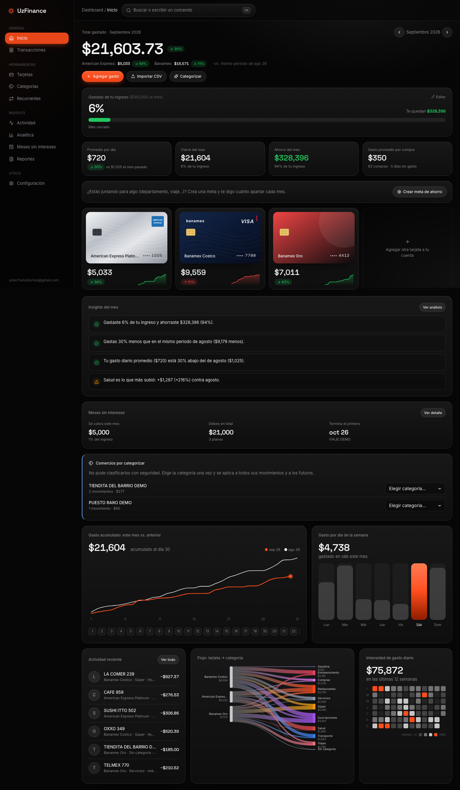

# UzFinance

Tracker personal de gastos con tarjetas (American Express, Banamex, Nu). Los gastos entran **automáticamente** desde un Atajo de iPhone (disparador *Wallet* —antes *Transacción*— de Apple Pay) y se consultan en un dashboard web. UI en español, moneda MXN, tema oscuro, pensada para usarse desde el iPhone.



> **Resumen operativo, pruebas, Gmail y Wallet en una sola página: [docs/GUIA.md](docs/GUIA.md).** Incluye ingreso mensual, insights (comparación con meses anteriores, promedio por día, proyección), tarjetas ilustradas y la app instalable en el celular.

- [Arquitectura](#arquitectura)
- [Seguridad](#seguridad)
- [Variables de entorno](#variables-de-entorno)
- [Correr en local](#correr-en-local)
- [Pruebas](#pruebas)
- [Azure: recursos y costo](#azure-recursos-y-costo)
- [Runbook de despliegue](#runbook-de-despliegue)
- [Rotación del token de ingesta](#rotación-del-token-de-ingesta)
- [Límites del plan gratuito (léelo)](#límites-del-plan-gratuito-léelo)
- [Guía del Atajo de iPhone](#guía-del-atajo-de-iphone)
- [Destruir todo (NO se ejecuta solo)](#destruir-todo-no-se-ejecuta-solo)
- [Solución de problemas](#solución-de-problemas)

## Arquitectura

```
 iPhone (Wallet/Apple Pay)                    Navegador (tú)
        │ disparador "Transacción"                  │ HTTPS
        ▼                                           ▼
   Atajo ── POST /api/ingest ───┐        ┌── App Service Authentication (Easy Auth)
   Authorization: Bearer <token>│        │   Entra ID · single-tenant · asignación obligatoria
                                ▼        ▼   (todo exige sesión, salvo /api/ingest: excludedPaths)
                     ┌──────────────────────────────────┐
                     │ Azure App Service F1 (Linux)     │
                     │ Next.js 16 (standalone, Node 24) │
                     │  · proxy.ts: sesión + CSP/nonce  │
                     │  · cada handler revalida sesión  │
                     └──────────────┬───────────────────┘
                                    │ Managed Identity (Entra), sin passwords
                                    ▼
                     Azure SQL Database (serverless, oferta gratuita, solo Entra)

 GitHub (main) ─ Actions: lint · typecheck · tests · e2e ─ OIDC (sin secretos) ─▶ deploy ─▶ smoke test
```

| Capa | Detalle |
|---|---|
| Web | Next.js 16 (App Router) + TypeScript + Tailwind v4; gráficas con Recharts y d3-sankey; validación con zod |
| Datos | SQL Server (Azure SQL en prod, SQL Server 2022 en docker local → mismo motor); consultas parametrizadas; montos en **centavos enteros**; reembolsos = monto negativo |
| Ingesta | `POST /api/ingest` → valida (zod estricto) → resuelve tarjeta (nombre, alias o últimos 4) → categoriza (reglas) → deduplica por hash |
| Fuentes | Interfaz `TransactionSource`: `shortcut` y `statement` (CSV genérico) implementadas. Correos de Banamex: ver [Ingesta de correos de Banamex](#ingesta-de-correos-de-banamex) |
| Categorización | Interfaz `Categorizer`: `CATEGORIZER=rules` (solo reglas) o `jev` (reglas → historial → [Jev](https://openrouter.ai/docs/guides/community/jev) vía OpenRouter, `src/lib/categorizer/jev.ts`) |
| Estados de cuenta y MSI | `scripts/statements` (extractores Python con verificación de totales) + `scripts/import-statements.ts`; planes a meses en `installment_plans` (página `/msi`). Ver [docs/GUIA.md §8](docs/GUIA.md) |
| Tiempo real | `LiveRefresh` revisa `/api/changes` con la pestaña visible y actividad reciente, y al volver a la pestaña; refresca solo cuando algo cambió |

**Deduplicación:** hash SHA-256 de `tarjeta + minuto + monto + comercio normalizado` (Atajo/manual). Para estados de cuenta (solo traen día) es `tarjeta + día + monto + comercio`, y además se omite si ya existe un movimiento no-estado con misma tarjeta, día y monto.

## Seguridad

| Control | Cómo |
|---|---|
| Todo exige sesión | Easy Auth con Entra ID; **únicas excepciones** `/api/ingest` y `/api/ingest/email` (`excludedPaths`), cada una con su propio token, más los estáticos públicos sin datos `/manifest.webmanifest` y `/icons/*` (necesarios para instalar la app en el celular) |
| Defensa en profundidad | El servidor valida `X-MS-CLIENT-PRINCIPAL` y compara el correo con `ALLOWED_EMAIL`. Match robusto del UPN de invitado (`usuario_gmail.com#EXT#@tenant`) además del claim `email`; y opcionalmente `tid` |
| Solo tu cuenta | Asignación de usuario obligatoria en la enterprise app + `allowedPrincipals` (tu object id) + `WEBSITE_AUTH_AAD_ALLOWED_TENANTS` + allowlist en código |
| Login sin secreto | Easy Auth usa una *federated identity credential* sobre una Managed Identity (no hay client secret) |
| Ingesta | Token largo aleatorio en `Authorization: Bearer`, comparación en tiempo constante, rate limit por IP (60/min y 10 tokens inválidos/10 min → 429), body máx. 8 KB, JSON estricto |
| `AUTH_MODE=dev` | Solo local. La app **se niega a arrancar** con dev en producción (o dentro de App Service); hay pruebas que lo verifican |
| Transporte y cabeceras | HTTPS only, TLS ≥ 1.2, HSTS, CSP con nonce, `X-Frame-Options: DENY`, `nosniff`, Referrer/Permissions-Policy, sin `X-Powered-By`; CORS cerrado |
| Anti-CSRF | Mutaciones rechazan `Origin` distinto del host; además exigen `application/json`/`text/csv` |
| Base de datos | Solo autenticación Entra (sin logins SQL ni passwords); la Managed Identity de la app tiene **solo `db_datareader` + `db_datawriter`** (sin DDL) |
| Despliegue | OIDC con credencial federada atada al repo/rama `main` (subject con IDs inmutables); rol *Website Contributor* solo sobre la Web App |
| Superficie de administración | FTPS deshabilitado, remote debugging apagado, credenciales básicas FTP/SCM deshabilitadas |
| Logs | No se registran payloads, montos ni el token; los errores 500 devuelven un mensaje genérico |
| Secretos | Solo como App Settings. Nada en el repo (`.env` ignorado; `.env.example` sin valores) |
| Presupuesto | Alerta de US$5/mes (50 %, 100 % real, 100 % proyectado) y alerta de cupo de la base gratuita |

> Los App Settings son visibles para quien tenga rol Owner/Contributor en la suscripción. Para un uso personal es suficiente; si quisieras más aislamiento, el siguiente paso sería Key Vault con referencias.

## Variables de entorno

Plantilla en [`.env.example`](.env.example). En Azure son *App Settings*.

| Variable | Local | Azure | Descripción |
|---|---|---|---|
| `AUTH_MODE` | `dev` | `easyauth` | `dev` salta el login (solo local; bloqueado en producción) |
| `ALLOWED_EMAIL` | tu correo | tu correo | Allowlist del correo que puede entrar |
| `ALLOWED_TENANT_ID` | — | tenant | Si se define, el claim `tid` debe coincidir |
| `EMAIL_INGEST_TOKENS` | aleatorio | aleatorio | Tokens del puente Gmail, `nombre=token,otro=token` (cada token ≥ 32). **Distinto** de `INGEST_TOKEN`; sin definir, el endpoint rechaza todo |
| `INGEST_TOKEN` | aleatorio | aleatorio | Token Bearer de `/api/ingest` (≥ 32 caracteres) |
| `INGEST_TOKEN_PREVIOUS` | — | solo en rotación | Token anterior aún válido durante la rotación |
| `CATEGORIZER` | `rules` | `rules` | `rules` o `jev` |
| `OPENROUTER_API_KEY` | — | — | API key de OpenRouter para Jev (secreto: App Setting en Azure) |
| `DB_SERVER`, `DB_PORT`, `DB_NAME` | `localhost`, 1433, `uzfinance` | `<srv>.database.windows.net`, —, `uzfinance` | Conexión |
| `DB_AUTH` | `password` | `msi` | `msi` = Managed Identity (sin passwords) |
| `DB_USER`, `DB_PASSWORD`, `DB_SA_PASSWORD` | docker local | — | Solo local |
| `DB_TRUST_SERVER_CERT` | `true` | `false` | Certificado del SQL local |
| `HOSTNAME`, `PORT`, `WEBSITES_PORT` | — | `0.0.0.0`, `8080`, `8080` | Necesarios para el servidor standalone en App Service |
| `OVERRIDE_USE_MI_FIC_ASSERTION_CLIENTID` | — | client id de la identidad | Easy Auth sin secreto |

## Correr en local

Requisitos: Node 24 y Docker (OrbStack o Docker Desktop).

```bash
cp .env.example .env     # completa INGEST_TOKEN, DB_PASSWORD y DB_SA_PASSWORD (mismo valor)
npm ci
npm run db:up            # SQL Server 2022 en docker (solo en 127.0.0.1)
npm run db:migrate && npm run db:seed
npm run dev              # http://localhost:3000  (AUTH_MODE=dev, sin login)
```

`npm run db:reset` borra y recrea la base local con datos de ejemplo. `seed` y `reset` **se niegan a correr** contra cualquier cosa que no sea la base local de docker.

Probar la ingesta en local:

```bash
curl -X POST localhost:3000/api/ingest \
  -H "Authorization: Bearer $(grep ^INGEST_TOKEN= .env | cut -d= -f2)" \
  -H "Content-Type: application/json" \
  -d '{"merchant":"OXXO","amount":"45.50","card":"Banamex Oro"}'
```

Contrato de `/api/ingest` (claves desconocidas se rechazan):

| Campo | Tipo | Notas |
|---|---|---|
| `merchant` | texto 1–120 | Comercio tal como lo manda Wallet |
| `amount` | texto o número | `"$1,234.50"`, `"MXN 99"`, `12.5`; reembolsos negativos |
| `card` | texto 1–80 | Nombre en Wallet, alias o últimos 4 |
| `date` | ISO 8601 con zona (opcional) | Si falta, hora del servidor |
| `notes` | texto ≤ 500 (opcional) | |

Respuestas: `200` `{"status":"inserted"\|"duplicate"}`, `400` validación, `401` token, `413` body grande, `415` content-type, `429` rate limit, `503` base despertando (reintentar). Cabecera opcional `X-Dry-Run: 1` valida sin escribir.

## Pruebas

```bash
npm run lint && npm run typecheck
npm run test:unit          # lógica pura: allowlist, token, dinero, CSV, reglas…
npm run test:integration   # API + SQL Server real (requiere db:up); base aparte `uzfinance_test`
npm run test:e2e           # build de producción + Playwright (desktop y mobile); base `uzfinance_e2e`
```

El e2e corre sobre el **build de producción** con `AUTH_MODE=easyauth` y el header de Easy Auth simulado, así se ejercita el mismo camino de seguridad que en Azure. Las capturas de diseño se regeneran en `docs/screenshots/`.

CI (`.github/workflows/ci.yml`) corre todo esto con un SQL Server efímero y password generado al vuelo.

## Azure: recursos y costo

Todo vive en el grupo de recursos **`rg-uzfinance`** (región `southcentralus`). Hay un único entorno (producción).

| Recurso | Nombre | Costo/mes |
|---|---|---|
| Azure SQL (servidor, solo Entra) | `uzfinance-sql-092d5` | $0 |
| Azure SQL Database (serverless, oferta gratuita, `AutoPause` al agotar) | `uzfinance` | $0 |
| App Service plan F1 (Linux) | `plan-uzfinance` | $0 |
| Web App (Node 24 LTS) | `uzfinance-092d5` → https://uzfinance-092d5.azurewebsites.net | $0 |
| Managed Identity de usuario (solo Easy Auth) | `id-uzfinance-auth` | $0 |
| Presupuesto US$5/mes con alertas | `budget-uzfinance` | $0 |
| Alerta de cupo SQL + grupo de acciones | `alert-sql-free-quota`, `ag-uzfinance` | $0 |
| App registrations (Entra) | `uzfinance-web`, `uzfinance-github-deploy` | $0 |

**Costo mensual esperado: US$0.** Región: la oferta gratuita de SQL serverless no existe en México Central; South Central US es la más cercana con disponibilidad, y se dejó la Web App en la misma región para minimizar latencia con la base.

## Runbook de despliegue

**Despliegue normal:** `git push` a `main` → [`deploy.yml`](.github/workflows/deploy.yml): CI completo → build standalone → `azure/login` (OIDC) → `az webapp deploy` → smoke test. Si algo falla, no se despliega.

Variables del repo (no son secretos): `AZURE_CLIENT_ID`, `AZURE_TENANT_ID`, `AZURE_SUBSCRIPTION_ID`, `AZURE_RESOURCE_GROUP`, `AZURE_WEBAPP_NAME`.

Redesplegar sin cambios: `gh workflow run deploy.yml`.
Rollback: `git revert <commit> && git push` (vuelve a pasar por el pipeline).

**Smoke test manual:** `bash scripts/smoke.sh https://uzfinance-092d5.azurewebsites.net [INGEST_TOKEN]`

### Migraciones de base de datos

El despliegue **no** modifica el esquema (la identidad de la app no tiene DDL). Las migraciones (`db/migrations/*.sql`) se aplican a mano con tu identidad Entra (administrador del servidor SQL), **antes** de desplegar código que las necesite:

```bash
az login                                   # con la cuenta administradora del servidor SQL
RG=rg-uzfinance; SRV=uzfinance-sql-092d5
MYIP=$(curl -s https://api.ipify.org)
az sql server firewall-rule create -g $RG -s $SRV -n tmp-migrate --start-ip-address $MYIP --end-ip-address $MYIP
sleep 20
DB_SERVER=$SRV.database.windows.net DB_NAME=uzfinance npx tsx scripts/azure-sql.ts migrate
az sql server firewall-rule delete -g $RG -s $SRV -n tmp-migrate      # ¡siempre cerrar la regla!
```

Escribe migraciones compatibles hacia atrás (agregar, no romper) para poder aplicarlas antes del código nuevo.

### Operación

```bash
# Ver el estado y los últimos logs
az webapp show -g rg-uzfinance -n uzfinance-092d5 --query state
az webapp log config -g rg-uzfinance -n uzfinance-092d5 --application-logging filesystem --level error
az webapp log tail   -g rg-uzfinance -n uzfinance-092d5

# Cupo gratuito restante de la base (vCore-segundos)
DBID=$(az sql db show -g rg-uzfinance -s uzfinance-sql-092d5 -n uzfinance --query id -o tsv)
az monitor metrics list --resource $DBID --metric free_amount_remaining --interval PT1H --aggregation Minimum -o table
```

## Ingesta de correos de Banamex

Un Google Apps Script en tu Gmail (`integrations/gmail-apps-script/`, con su propia guía) envía cada 5 min los avisos de
`notificaciones@banamex.com` a `POST /api/ingest/email`. Cuerpo: `{messageId, from, subject, receivedAt, bodyText}`.

| Respuesta | Significado |
|---|---|
| `200 {status: created \| merged \| duplicate \| ignored \| unparsed}` | resultado idempotente (reenviar no duplica) |
| `400` payload inválido · `403` remitente distinto de `notificaciones@banamex.com` · `413` > 64 KB · `415` no JSON | |
| `401` token inválido · `429` demasiados intentos · `503` base despertando (reintentar) | |

`X-Dry-Run: 1` valida y reporta cómo se interpretaría (`parsed` / `ignored` / `unparsed` + motivo) sin escribir.

**Seguridad.** Token Bearer propio (varios con nombre, comparación en tiempo constante), distinto al del Atajo para revocarlos por
separado; fuera de Easy Auth; límite de 64 KB; 120 req/min por IP y bloqueo tras 10 tokens inválidos. El cuerpo del correo es entrada **no
confiable**: regex acotadas sobre etiquetas conocidas, nada se interpreta como instrucción, no se registra en logs y **no se guarda**
(solo campos interpretados + `messageId`). Un correo que no se entiende se guarda en `unparsed_emails` **sin cuerpo** (id, remitente,
asunto, fecha y motivo) y aparece en el dashboard como *Pendiente de revisión*.

**Parser** (`src/lib/sources/banamex-email.ts`, puro y probado con fixtures ficticios): despacha por asunto; lee la fila «Fecha y hora»
(no el encabezado) en 4 formatos, zona UTC-6 fija → se guarda en UTC; monto en centavos (acepta `$ 159.00 M.N.`; otra moneda → pendiente);
solo `Estatus = Exitoso` cuando existe. Comercio crudo + normalizado (sin sufijos de ciudad/país) → `category_rules`.

| Asunto | `kind` |
|---|---|
| Retiro/Compra con tarjeta Banamex / tarjeta adicional / cuenta Banamex | `expense` |
| Cargo a cuenta para pago a Establecimiento | `expense` recurrente; **`card_payment`** si el comercio es una tarjeta mía (lista editable en *Configuración → Domiciliaciones que son pago de tarjeta*; por defecto American Express / Amex) |
| Depósito a Cuenta o Tarjeta Banamex | `card_payment` (si es a una cuenta de débito, se ignora) |
| Alta/modificación de cuenta, NIP, preferencias, rechazos, límites, ahorro fácil, bienvenida | ignorado |

`card_payment` queda fuera de **todos** los totales y gráficas (si no, sumaría doble con las compras de la Amex) y se muestra en
*Pagos de tarjeta* (Inicio y `/transacciones?kind=card_payment`).

**Tarjetas.** Clave única = **producto + bandera de adicional + dígitos** (`EXPLORA-BANAMEX|ADIC|000`; el débito usa producto `DEBITO`). Si ya
tienes una tarjeta Banamex con esos dígitos se adopta; si no, se crea **sin nombrar** y el dashboard te pide nombrarla (y ponerle el alias de Wallet).
Las **domiciliaciones no crean tarjeta**: la «Cuenta de cargo» se guarda como referencia de la transacción (`account_ref`, se muestra
«Domiciliación ···NNN») y el cargo cuelga de una tarjeta de sistema llamada *Domiciliación*. Un **pago de tarjeta** por domiciliación se
liga a la tarjeta cuyos últimos dígitos coincidan con la «Referencia establecimiento» del correo (solo si es inequívoca; si no, a *Domiciliación*).
Fechas: se interpretan en la zona IANA de la app (`America/Mexico_City`, `src/lib/time.ts`) y se guardan en UTC.

**Fusión con el Atajo.** Misma tarjeta + mismo monto + ≤ 15 min → una sola transacción, en cualquier orden de llegada. El correo manda
(comercio, autorización, fecha, estatus) y la fila conserva `sources = shortcut,email`. Los reintentos del Atajo después de fusionar siguen
siendo duplicados (`merged_hashes`). Un Atajo en tarjeta Banamex sin correo tras 24 h se marca *Sin confirmación bancaria* (la Amex no aplica).
Límite conocido: dos compras idénticas (misma tarjeta y monto) a < 15 min entre sí pueden cruzarse si solo llega un correo.

**Tokens del puente.**

```bash
# crear (no lo pegues en chats ni en el repo)
openssl rand -base64 36 | tr '+/' '-_'
# publicar: nombre=token; para rotar, deja ambos un rato (gmail=NUEVO,viejo=ANTERIOR) y luego quita el viejo
az webapp config appsettings set -g rg-uzfinance -n uzfinance-092d5 --settings "EMAIL_INGEST_TOKENS=gmail=<token>"
```

## Rotación del token de ingesta

El token vive solo en el App Setting `INGEST_TOKEN` (y en tu Atajo). Cada cambio de App Settings reinicia la app (unos segundos). Rotación **sin cortes**, en dos fases:

```bash
RG=rg-uzfinance; APP=uzfinance-092d5

# 0) Ver el token actual (no lo pegues en chats ni commits)
az webapp config appsettings list -g $RG -n $APP --query "[?name=='INGEST_TOKEN'].value | [0]" -o tsv

# 1) Generar uno nuevo y dejar el viejo como "previo" (ambos válidos)
OLD=$(az webapp config appsettings list -g $RG -n $APP --query "[?name=='INGEST_TOKEN'].value | [0]" -o tsv)
NEW=$(openssl rand -base64 48 | tr -d '=+/\n' | cut -c1-56)
az webapp config appsettings set -g $RG -n $APP --settings INGEST_TOKEN="$NEW" INGEST_TOKEN_PREVIOUS="$OLD" -o none
echo "$NEW" | pbcopy && echo "Token nuevo copiado al portapapeles"

# 2) Pega el token nuevo en el Atajo (encabezado Authorization: Bearer …) y dispara una prueba

# 3) Retirar el viejo
az webapp config appsettings delete -g $RG -n $APP --setting-names INGEST_TOKEN_PREVIOUS -o none
unset OLD NEW
```

**Si el token se filtró:** salta la fase de "previo": genera `NEW`, `set INGEST_TOKEN="$NEW"` y `delete INGEST_TOKEN_PREVIOUS` de inmediato; el Atajo dejará de funcionar hasta que lo actualices. Después revisa la actividad (`source = shortcut`) por movimientos que no reconozcas.

## Límites del plan gratuito (léelo)

**App Service F1:** cuota de CPU de 60 min/día compartida, 1 GB de RAM, sin *Always On* (la app se duerme sin tráfico y la primera visita tarda), un solo proceso (el rate limiter en memoria funciona porque no hay escalado horizontal). Si alguna vez molesta, el siguiente escalón es B1 (≈ US$13/mes).

**Azure SQL gratuita (serverless):**

- Cupo: **100,000 vCore-segundos/mes** y 32 GB. Se renueva cada mes calendario.
- Mientras está despierta consume **al menos 0.5 vCore → 1,800 vCore-s por hora despierta → ≈ 55 horas despierta al mes (≈ 1.8 h/día)**.
- La base se pausa tras **60 min sin actividad** y ese tiempo **no se puede cambiar** en la oferta gratuita. Cada visita o gasto del Atajo la despierta ≥ 60 min.
- Si el uso es muy repartido (muchos gastos en horas distintas), **el cupo puede agotarse antes de fin de mes**. Entonces la base se pausa hasta el mes siguiente: el dashboard falla y `/api/ingest` responde 503 (el Atajo reintenta, pero tras agotar el cupo no hay datos que guardar hasta el nuevo mes).
- Por eso hay una **alerta por correo** cuando quedan < 30,000 vCore-s. Si te llega temprano en el mes, las opciones son: (a) cambiar a *BillForUsage* (irreversible; se paga solo el excedente, ≈ US$0.26 por hora despierta), (b) un plan fijo (SQL *Basic* ≈ US$5/mes, siempre despierta) o (c) migrar a Cosmos DB free tier (sin pausa, requiere reescribir la capa de datos).
- `LiveRefresh` está diseñado para **no** mantener despierta la base: solo consulta con la pestaña visible y actividad en los últimos 5 min.
- **Arranque en frío:** la primera consulta tras una pausa tarda 30–60 s. `/api/ingest` reintenta la conexión y, si no alcanza, responde `503` con `Retry-After`; el Atajo debe reintentar (ver guía).

## Guía del Atajo de iPhone

Requisitos: iPhone con iOS que incluya el disparador **Transacción** (Atajos → Automatización), tus tarjetas en Wallet y el token de ingesta (comando de la sección de rotación, paso 0).

> Los nombres de las variables y acciones pueden variar ligeramente según la versión de iOS; la idea es la misma.

### 1. Registra tus tarjetas en UzFinance

En **Tarjetas** crea Amex, tus Banamex y Nu (el emisor define el color y el desglose). El campo **Alias** debe contener el nombre como lo manda Wallet (separa varios con coma, p. ej. `Nu, NuBank`). No distingue mayúsculas ni acentos. También se reconoce por **últimos 4 dígitos**.

Si el nombre no coincide con ninguno, el gasto **no se pierde**: entra a la tarjeta *Sin asignar* y en sus **notas** queda `Tarjeta sin reconocer: "<texto recibido>"`. Copia ese texto como alias de la tarjeta correcta y reasigna el movimiento (editar).

### 2. Crea la automatización

1. **Atajos → Automatización → + → Nueva automatización → Transacción**.
2. Elige las tarjetas a monitorear (todas las que quieras registrar).
3. Siguiente → agrega las acciones de abajo.
4. Al final elige **Ejecutar inmediatamente** y desactiva **Notificar al ejecutar**, para que corra sin pedir confirmación.

### 3. Acciones (en este orden)

1. **Fecha actual**.
2. **Formatear fecha** → Formato de fecha: **ISO 8601**.
3. **Obtener contenido de URL**:
   - **URL:** `https://uzfinance-092d5.azurewebsites.net/api/ingest`
   - **Método:** `POST`
   - **Encabezados:**
     - `Authorization` = `Bearer ` + tu token (con un espacio después de *Bearer*)
     - `Content-Type` = `application/json`
   - **Cuerpo de la solicitud:** JSON, con estos campos (los valores son *variables mágicas* de la entrada **Transacción**):

     | Clave | Tipo | Valor |
     |---|---|---|
     | `merchant` | Texto | **Comercio** de la transacción |
     | `amount` | Texto | **Monto** de la transacción |
     | `card` | Texto | **Tarjeta o pase** (nombre) |
     | `date` | Texto | **Fecha con formato** (paso 2) |

   El monto puede venir como `$123.45`, `MXN 123.45`, etc.; el servidor lo interpreta. Los reembolsos deben llegar con signo negativo: **revisa tus primeras transacciones reales** para confirmar cómo los reporta tu iOS.

### 4. Reintentos (arranque en frío de la base)

Si la base estaba pausada, la primera llamada puede tardar o responder `503`. El servidor es idempotente (deduplica), así que reintentar es seguro. Envuelve la acción *Obtener contenido de URL* así:

```
Repetir 4 veces
  Obtener contenido de URL        ← la acción de arriba
  Si  Contenido de URL  contiene  "status"      ← "inserted" o "duplicate": ya quedó guardado
    Detener este atajo
  Fin Si
  Esperar 45 segundos
Fin Repetir
```

### 5. Probar sin gastar

Las automatizaciones de Transacción no se pueden disparar a mano con datos reales, así que prueba el endpoint por separado.

- **Desde la terminal** (validación sin escribir, `X-Dry-Run`):
  ```bash
  curl -s -X POST https://uzfinance-092d5.azurewebsites.net/api/ingest \
    -H "Authorization: Bearer <TOKEN>" -H "Content-Type: application/json" -H "X-Dry-Run: 1" \
    -d '{"merchant":"PRUEBA","amount":"1.00","card":"Nu"}'
  # → {"status":"ok","dryRun":true}
  ```
- **Desde el iPhone:** duplica el atajo como uno normal ("Probar UzFinance"), reemplaza las variables por texto fijo (`PRUEBA`, `1.00`, el alias de tu tarjeta) y agrega **Mostrar resultado** al final. Debe responder `{"status":"inserted",…}`; bórralo después desde **Transacciones**.

Códigos que verás: `200` listo · `401` token incorrecto (revisa `Bearer ` y el token) · `400` campo faltante/mal formado · `429` demasiados intentos · `503` base despertando (reintenta).

## Destruir todo (NO se ejecuta solo)

> **Irreversible.** Elimina la base y todos tus datos. Antes exporta lo que quieras conservar (Reportes → CSV por mes). Estos comandos están aquí solo como documentación; no los ejecutes sin estar seguro.

```bash
# 1) Todo lo que vive en el grupo de recursos (Web App, plan, SQL + base, identidad, presupuesto, alertas)
az group delete -n rg-uzfinance --yes --no-wait

# 2) App registrations en Entra (viven fuera del grupo de recursos)
az ad app delete --id "$(az ad app list --display-name uzfinance-web --query '[0].appId' -o tsv)"
az ad app delete --id "$(az ad app list --display-name uzfinance-github-deploy --query '[0].appId' -o tsv)"

# 3) Variables del repositorio (opcional)
for v in AZURE_CLIENT_ID AZURE_TENANT_ID AZURE_SUBSCRIPTION_ID AZURE_RESOURCE_GROUP AZURE_WEBAPP_NAME; do gh variable delete $v; done

# 4) Opcional: quitar a tu Gmail invitado del tenant
az ad user delete --id "uziel.francotorres_gmail.com#EXT#@<tu-tenant>.onmicrosoft.com"
```

Local: `npm run db:down` y `docker volume rm uzfinance_uzfinance-db` borran la base de docker.

## Solución de problemas

| Síntoma | Causa probable / qué hacer |
|---|---|
| El navegador muestra 401/403 tras iniciar sesión | La cuenta no está asignada a la enterprise app `uzfinance-web`, o su correo no coincide con `ALLOWED_EMAIL`. Revisa asignación y el claim real en `/.auth/me` (con sesión iniciada) |
| El Atajo recibe 401 | Token incorrecto o falta el espacio en `Bearer <token>`; si rotaste, actualiza el Atajo |
| El Atajo recibe 503 o tarda | Base despertando; reintenta. Si persiste el mes completo, se agotó el cupo gratuito (ver sección de límites) |
| Un gasto cae en "Sin asignar" | El nombre de la tarjeta no coincide con ningún alias; ver notas del movimiento y agrega el alias |
| La primera visita es lenta | App Service F1 sin *Always On* + base pausada; es normal tras horas de inactividad |
| El deploy falla en `azure/login` | La credencial federada debe coincidir con el *subject* real del token (incluye IDs inmutables del repo); el log del paso lo muestra |
| El deploy pasa pero la app no arranca | Revisa `az webapp log tail`; en Linux el servidor standalone necesita `HOSTNAME=0.0.0.0` y `PORT=8080` |
| `npm run typecheck` falla en limpio | Corre `npm run typecheck` (genera primero los tipos de rutas de Next) |
